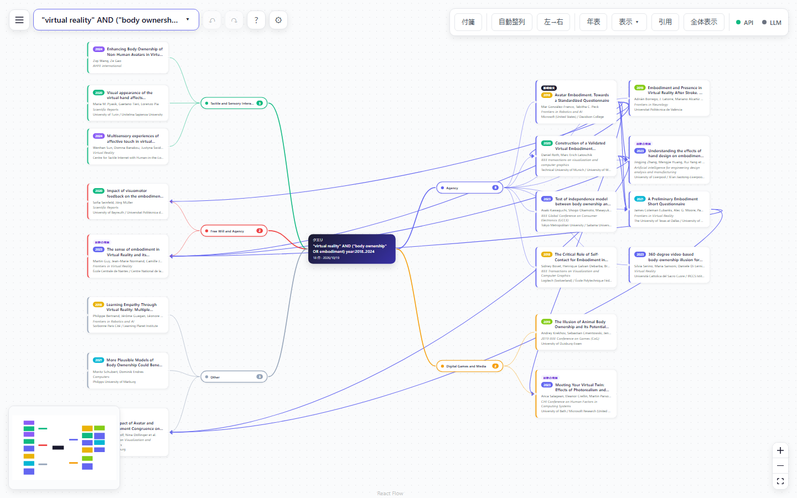
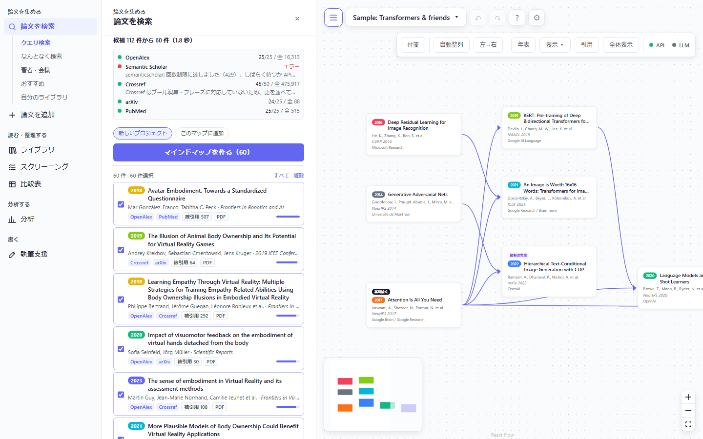
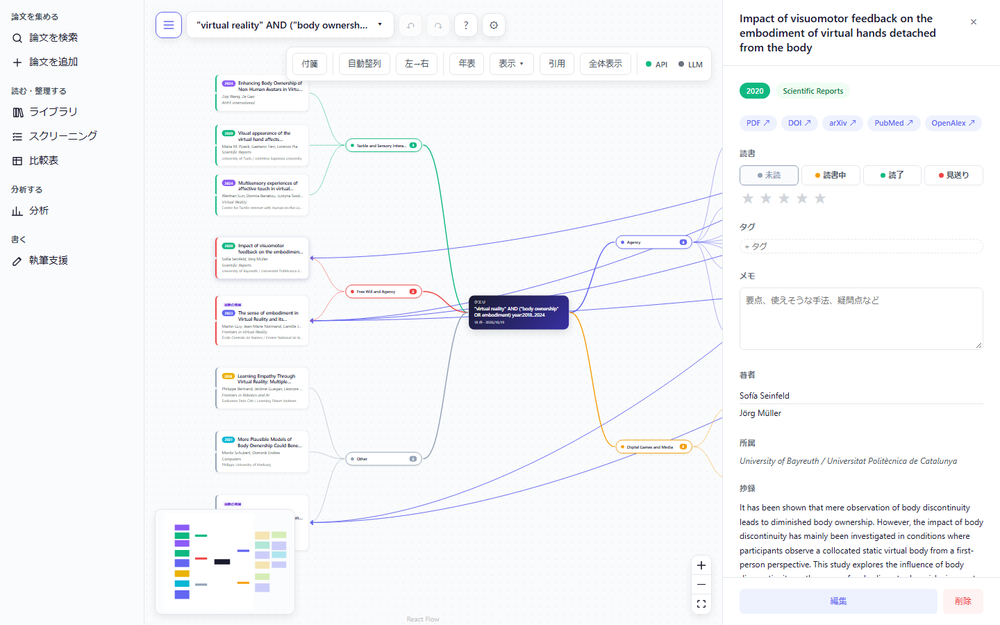
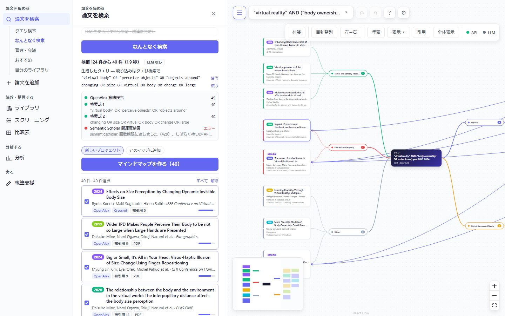
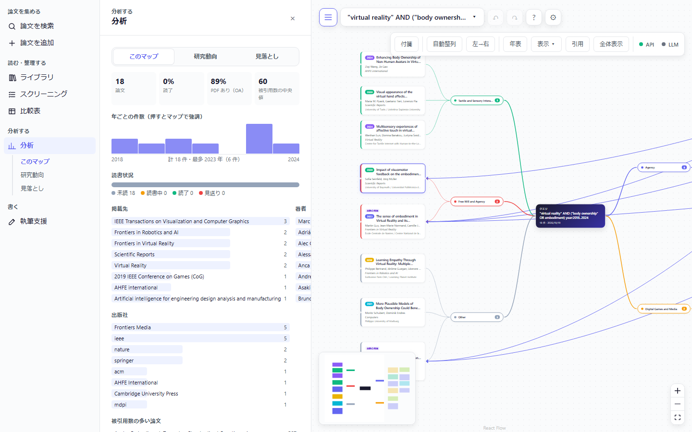
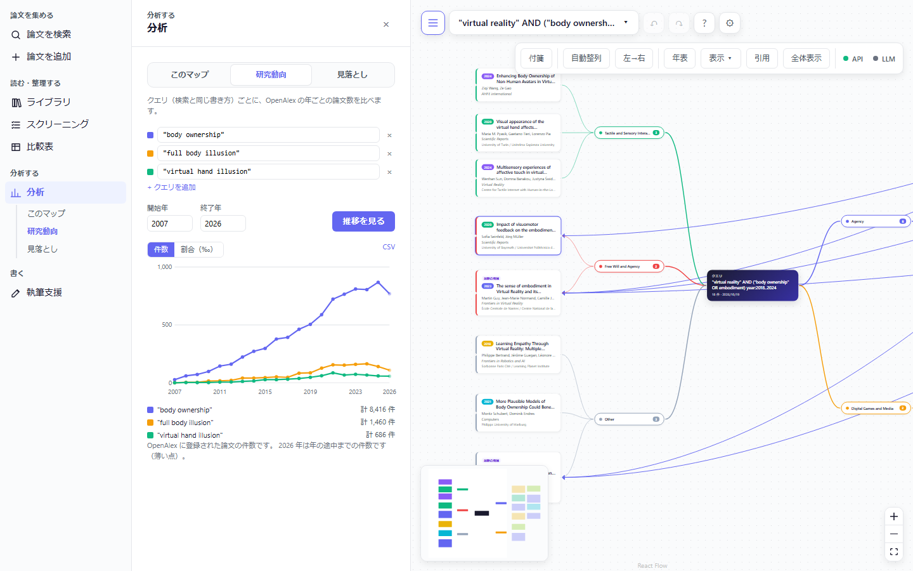
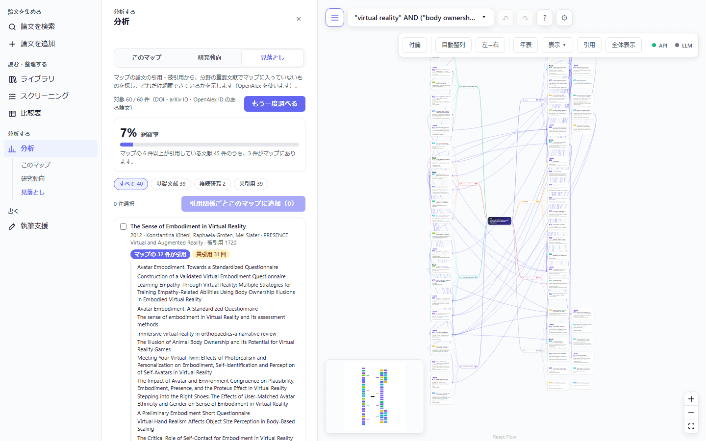
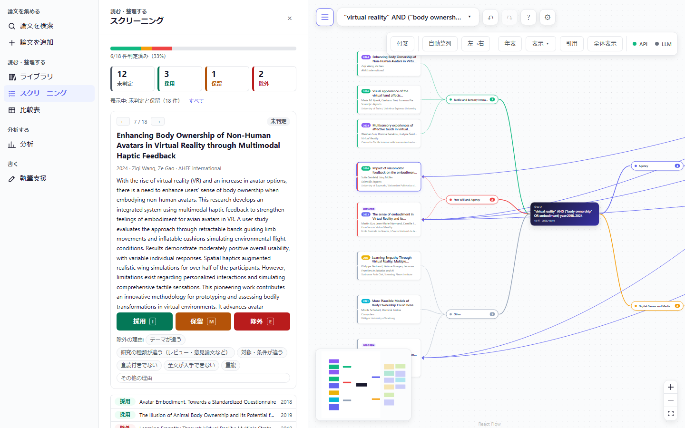
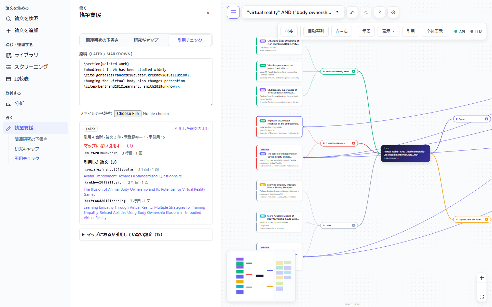
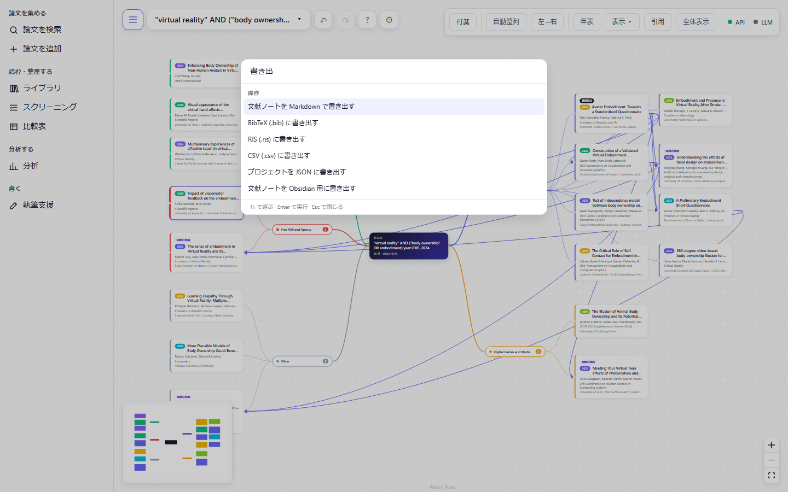

# Research Mind Map

論文データベースを横断検索して、研究領域のマインドマップを作るアプリです。検索した論文はマップの上で読み、整理し、関係を調べ、論文の執筆までそのまま使えます。



- [使用例](#使用例) — 画面で見る使い方
- [機能](#機能) — 何ができるか
- [はじめかた](#はじめかた) — インストールと起動
- [技術](#技術) — 仕組みと構成
- [セキュリティとプライバシー](#セキュリティとプライバシー)
- [ドキュメント](#ドキュメント)・[コントリビュート](#コントリビュート)・[ライセンス](#ライセンス)

---

## 使用例

「VR で自分の体だと感じる感覚（body ownership）」の研究を調べ、マップにして、文献を整理し、論文を書くまでの流れです。画面はすべて API キーなし（Claude なし）の状態で撮っています。

### 1. クエリで論文を探す

左上の ☰ で機能メニューを開き、「論文を集める › 論文を検索」を選びます。ACM DL や Scopus と同じ書き方の検索式で、複数のデータベースをまとめて検索します。データベースごとの件数や失敗も表示され、結果を選んで「マインドマップを作る」を押すとマップになります。

```
"virtual reality" AND ("body ownership" OR embodiment) year:2018..2024
```



### 2. マップで読む

検索式を中心に、トピックのまとまり（クラスタ）ごとに論文が並び、引用関係が矢印で引かれます（一番上の画像）。論文を押すと、右に抄録・PDF などへのリンク・読書状態・タグ・メモが開きます。



### 3. 言葉にしにくいときは「なんとなく検索」

探したい研究を文章で書くと、意味の近い論文を探します。作られた検索式も表示されるので、「使う」でクエリ検索に移って絞り込めます。



### 4. 分析する

「分析」では、マップの論文を年・掲載先・出版社・著者などで集計します。「研究動向」では、複数のクエリの年ごとの論文数を折れ線で比べられます。

| マップの統計 | 研究動向 |
|---|---|
|  |  |

### 5. 見落としを確かめる

「分析 › 見落とし」で、マップの論文の多くが引用しているのにマップに無い文献を探します。網羅率（よく引用される文献のうちマップにある割合）と、根拠になったマップの論文が分かり、選んで引用関係ごとマップに追加できます。下の例では、検索で集めた 18 件の網羅率は 2% で、そのうち 12 件が引用している分野の基本文献 Kilteni 2012「The Sense of Embodiment in Virtual Reality」がマップに無いことが分かります。



### 6. 整理する（スクリーニング）

系統的レビューでは、論文を 1 件ずつ採用・保留・除外に振り分けます（キーボードの I / M / E）。判定ごとの件数を押すとその論文だけを見直せ、PRISMA の流れ図も作られます。



### 7. 書く（原稿の引用チェック）

LaTeX や Markdown の原稿を貼ると、マップにない引用キー・引用した論文・まだ引用していない論文が分かります。引用した論文だけの .bib も書き出せます。



### 8. 名前で呼び出す（コマンドパレット）

Ctrl / ⌘ + K で、操作や論文を名前で探して実行できます。



---

## 機能

研究の流れ（**探す → 読む・整理する → 関係を理解する → 書く → 共有する**）に沿って並べています。機能ごとの詳細と ID は [docs/FEATURES.md](docs/FEATURES.md) にあります。

### 探す

| 機能 | 内容 |
|---|---|
| 横断クエリ検索 | ACM DL・IEEE Xplore・Scopus・PubMed などの書き方のブール検索で、OpenAlex・Semantic Scholar・Crossref・arXiv・PubMed・IEEE Xplore・DBLP をまとめて検索します。入力中に構文の誤りの位置を示します |
| なんとなく検索 | 「こういう研究」を自然文（日本語可）で書くと、意味の近い論文を探します。展開された検索式を見て、そのまま厳密な検索へ移れます |
| 絞り込み | 年、出版社（ACM・IEEE など）、オープンアクセスを、チップかクエリ（`year:2020..` `publisher:acm` `oa:true`）で指定します |
| 識別子から追加 | DOI・arXiv ID・URL・題名を貼り付けて取り込みます。「論文を追加」の中でクエリ検索もできます |
| 自分のライブラリ検索 | 保存したすべてのプロジェクトの論文を、題名・著者・タグ・メモなどで手元で探し、今のマップへ持ってきます |
| 参考文献リストの取り込み | 論文末尾の参考文献をそのまま貼ると、1 件ずつに分けて照合します。PDF からのコピーで崩れた改行もつなぎ直します。確信が低い一致は「要確認」として示します |
| 引用をたどる | 論文から参考文献（後方）と被引用（前方）を取得してマップに足します |
| おすすめ | 選んだ論文群と共引用・引用関係の近い論文を提案します |
| 見落とし論文の発見 | マップの論文の多くが引用している・一緒に引用されている文献でマップに無いものを、根拠の論文つきで示し、網羅率を出します。引用関係ごとマップに追加できます |
| 著者・会議から探す | 著者や会議を選んで論文をまとめて取得し、年ごとの推移を見ます |
| 検索履歴・新着アラート | 実行したクエリを記録して再実行でき、保存したクエリの新着を確認できます |

### 読む・整理する

| 機能 | 内容 |
|---|---|
| プロジェクト | 複数のマップをブラウザに保存して切り替えます |
| 読書状態・タグ・メモ・評価 | 未読 / 読書中 / 読了 / スキップ、自由なタグ、Markdown のメモ、星 5 段階 |
| ライブラリ | 全論文を表で並べ替え・絞り込みします。タグの名前の変更・統合・削除もまとめてできます |
| 文献チェック | 撤回された論文、公開版のあるプレプリント、重複、書誌の欠けを見つけ、公開版への置き換えや重複の統合をします |
| スクリーニング | 系統的レビュー用に採用 / 保留 / 除外と除外理由を付けます。判定ごとに絞って見直せ、PRISMA の流れ図と Markdown を出します |
| 比較表 | 論文 × 観点（手法・データセット・評価など）の表を作り、CSV で出します |
| 要約・翻訳 | 抄録の日本語要約と要点の箇条書き、抄録の翻訳（Claude を使用。要約はキーなしでも簡易版が動く） |

### 関係を理解する

| 機能 | 内容 |
|---|---|
| マインドマップ | 検索結果から「クエリ → トピックのクラスタ → 論文」の地図と引用関係を自動で作ります |
| 表示の切り替え | 年・クラスタ・読書状態・ソースで色分けし、ノードの大きさで被引用数を示します。時系列の配置や共著ネットワークの表示もできます |
| マップ内の検索 | 文字列・年・タグで論文を強調表示します |
| 重要論文の印 | マップ内でよく引用される「基礎論文」と「最新の発展」に印を付けます |
| 付箋 | 自由なメモをマップに置き、論文とつなげます |
| 分析 | マップの論文を年・掲載先・著者・タグ・読書状態などで集計します。研究動向では、最大 5 つのクエリの年ごとの論文数を折れ線で比べます |
| 研究ギャップ | 各論文の課題と今後の展望を集め、未解決の問題を整理します |

### 書く

| 機能 | 内容 |
|---|---|
| 文献の書き出し | BibTeX・RIS・CSV。APA / IEEE / ACM 形式の参考文献もコピーできます |
| 文献の取り込み | 手元の BibTeX / RIS を取り込みます。引用キーはそのまま残ります |
| 原稿の引用チェック | LaTeX / Markdown の原稿を貼ると、マップにない引用キー（綴り違いの候補つき）と、まだ引用していない論文を示します。引用した論文だけの .bib も出せます |
| 関連研究の下書き | 選んだ論文とクラスタから Related Work の下書きを作ります（引用キーつき） |
| 研究課題の整理 | 研究ギャップから研究課題と貢献の案を出します |
| 文献ノート | メモ・タグ・比較表の値を論文ごとにまとめ、Markdown 1 ファイルか Obsidian 用のフォルダ（zip）で出します |

### 共有・操作

| 機能 | 内容 |
|---|---|
| バックアップ | プロジェクトを JSON で書き出し・読み込みます |
| 画像出力 | マップを PNG / SVG で保存します |
| 元に戻す / やり直す | マップと論文の編集を戻せます |
| 機能メニュー | 画面左の ☰ で開閉する、「論文を集める / 読む・整理する / 分析する / 書く」の階層のメニュー |
| コマンドパレット | Ctrl / ⌘ + K で、操作と論文を名前（日本語・英語）で探して実行します |
| 設定 | 使うソース、ソースごとの件数、Claude の利用の有無を変え、各 API の状態を確認します |
| 表示言語 | 日本語と英語を切り替えます |

主なキー操作: `/` 検索欄へ、`F` 全体を表示、`Ctrl / ⌘ + Z` 元に戻す、`Ctrl / ⌘ + K` コマンドパレット、`?` ショートカット一覧。キャンバスをダブルクリックすると付箋を置きます。パネルのタブは ← → で切り替えられます。

### クエリの書き方（例）

```
"graph neural network" AND (title:recommendation OR abstract:"collaborative filtering") year:2019..2024
TITLE-ABS-KEY("virtual reality" AND "size perception") publisher:(acm OR ieee)
author:"Hinton" NOT title:survey oa:true
```

`AND` `OR` `NOT` は大文字で書きます。フィールド（`title:` `abstract:` `author:` `venue:` など）は直後の 1 語かフレーズ・括弧に掛かります。各データベースの別名（`TI=`、`[tiab]`、`"Document Title":` など）も受け付けます。全体の文法は [設計書 5.2](docs/DESIGN.md#52-クエリ言語-rqlresearch-query-language) にあります。

---

## はじめかた

使い方に合わせて 4 通りの起動方法があります。どれもこのマシンからだけ使えます。

### 0. Windows アプリ（いちばんかんたん。インストール不要）

1. [Releases](https://github.com/usamaru33/ResearchMindmap/releases/latest) から `ResearchMindmap.exe` をダウンロード
2. ダブルクリックすると、ブラウザでアプリが開きます。黒いウィンドウを閉じると終了します
3. APIキーを使うときは `%APPDATA%\ResearchMindmap\.env`（初回起動で作られます）を編集して、起動し直します

exe はコード署名していないので、「Windows によって PC が保護されました」と出ることがあります。GitHub がビルドした本物か確かめてから「詳細情報」→「実行」を選んでください。

```powershell
(Get-FileHash .\ResearchMindmap.exe -Algorithm SHA256).Hash   # リリースの SHA256SUMS.txt と同じか
gh attestation verify .\ResearchMindmap.exe --repo usamaru33/ResearchMindmap
```

自分でビルドするなら `npm ci && npm run build && npm run build:exe`（Windows で）→ `release/ResearchMindmap.exe`。

### A. Docker で動かす（Node.js は不要）

必要なもの: [Docker](https://docs.docker.com/get-docker/)（Docker Desktop など）

```bash
git clone <このリポジトリの URL>
cd ResearchMindmap
cp .env.example .env     # 任意。APIキーを使うときだけ（.env はコミットしないこと）
docker compose up --build
```

http://localhost:8787 を開きます。止めるときは `Ctrl + C`（裏で動かすなら `docker compose up -d --build`、止めるのは `docker compose down`）。

### B. Node.js で 1 コマンドで動かす

必要なもの: Node.js 22 以上（[.nvmrc](.nvmrc)）

```bash
npm ci                   # package-lock.json どおりに入れる
cp .env.example .env     # 任意
npm run app              # 画面を作ってから起動。http://localhost:8787 を開く
```

### C. 開発する

```bash
npm ci
npm run dev              # http://localhost:5173 を開く（変更がすぐ反映される。API サーバーは 127.0.0.1:8787）
```

最初はサンプルのマップが開きます。左上の ☰ で機能メニューを開き、「論文を集める › 論文を検索」から検索してマップを作ってください。データはブラウザに保存されるので、大事なプロジェクトはプロジェクトメニューから JSON に書き出しておくと安心です。

### APIキー（すべて任意）

キーがなくても動きます（抄録の翻訳だけは `ANTHROPIC_API_KEY` が必要）。設定すると取得できる件数や安定性が上がります。

| 変数 | 無いとき |
|---|---|
| `OPENALEX_API_KEY` | 同じ IP の利用者で共有する、少ない無料枠（$0.10/日）で動く。無料のキーで $1/日 になる |
| `SEMANTIC_SCHOLAR_API_KEY` | 回数制限（429）で結果が欠けることがある |
| `IEEE_API_KEY` | IEEE Xplore は使わない（IEEE の論文は OpenAlex / Crossref から取る） |
| `NCBI_API_KEY` | PubMed の回数上限が低い |
| `ANTHROPIC_API_KEY` | Claude を使う機能は、Claude なしの代替処理で動く（下記） |

そのほか `CROSSREF_MAILTO`（Crossref の polite pool 用の連絡先。Crossref に送られます）、`ENABLE_DBLP`（DBLP を使う）、`CACHE_DIR` / `CACHE_TTL_HOURS`（応答キャッシュ）、`HOST` / `ALLOWED_HOSTS` / `ALLOWED_ORIGINS`（API を受け付ける範囲。下記）があります。一覧は [.env.example](.env.example) を見てください。

---

## 技術

### 構成

```
ブラウザ（React + Vite）                          API サーバー（Node + Hono）
  検索・マップ・ライブラリ・執筆支援の画面   ──/api/*──▶  routes/   入力を zod で検証
  状態: useReducer（元に戻す付き）                       query/    RQL パーサー（shared/ と共有）
  保存: localStorage                                    sources/  各データベースのアダプタ
                                                        core/     統合・順位付け・クラスタ・グラフ
                                                        llm/      Claude（任意）
                                                        infra/    HTTP・レート制限・キャッシュ
```

バックエンドを置くのは、arXiv・DBLP・IEEE がブラウザから直接呼べない（CORS）ため、APIキーをブラウザに出さないため、無料枠を節約するためにキャッシュとレート制限をまとめるためです。

### 使っている技術

| 分野 | 採用 |
|---|---|
| フロントエンド | React 19、TypeScript、Vite、CSS Modules |
| マップの描画・配置 | @xyflow/react（React Flow）、dagre、独自のマインドマップ配置・時系列配置 |
| API サーバー | Hono + @hono/node-server、tsx |
| 入力検証・構造化出力 | zod |
| XML（arXiv・PubMed） | fast-xml-parser |
| 画像出力 | html-to-image |
| LLM | @anthropic-ai/sdk（既定モデル `claude-opus-5-5`、`ANTHROPIC_MODEL` で変更可） |
| テスト・品質 | Vitest、ESLint（typescript-eslint、react-hooks）、`tsc -b` |

状態管理ライブラリやデータベースは使っていません。データはすべてブラウザの `localStorage`（キー `rmm:v1:*`）にあり、サーバーは状態を持ちません。

### データソース

| ソース | 主な用途 | 備考 |
|---|---|---|
| OpenAlex | 基幹。全分野の検索、引用関係、トピック、意味検索、撤回・公開版の確認、年次集計 | |
| Semantic Scholar | 関連度検索 | 無キーでは 429 が多い |
| Crossref | DOI の書誌、出版社での絞り込み、参考文献の照合 | |
| arXiv | プレプリント | 3 秒に 1 回の間隔を守る |
| PubMed | 医学・生命科学 | |
| IEEE Xplore | IEEE の公式検索 | キーがあるときだけ |
| DBLP | 計算機科学の会議録 | ボット対策で失敗することがあるため既定で無効 |

ACM DL と Google Scholar には公開 API がないため直接は取得しません。ACM の論文は OpenAlex / Crossref の DOI プレフィックス（`10.1145`）で絞り込みます。

### 横断検索の流れ

1. **解析**: クエリを RQL（ACM・IEEE・Scopus・PubMed などの書き方をまとめた独自のクエリ言語）として一つの構文木にします。パーサーは `shared/query/` にあり、画面の構文チェックにも使います
2. **変換と取得**: 各ソースのアダプタが構文木をそのソースの検索条件に変換し、並列に取得します。表現できない部分（Crossref のブール演算など）は緩めて取得し、警告を出します。失敗したソースは記録して、ほかのソースの結果を返します
3. **統合**: DOI・arXiv ID・正規化した題名で重複をまとめ、Reciprocal Rank Fusion（RRF）で順位を付けます
4. **補完と再判定**: OpenAlex から抄録・トピック・参考文献・被引用数を一括で補い、近似でしか検索できなかったソースの結果は構文木で評価し直します
5. **マップ生成**: 参考文献の交差から引用関係を作り、トピック階層とキーワードの 2 方式でクラスタを計算して、まとまりの良い方を使います

### なんとなく検索の流れ

OpenAlex の意味検索（埋め込み）、Claude による検索式の展開、Semantic Scholar の関連度検索の 3 経路で候補を集め、RRF で統合します。その後、説明文との近さで並べ直します（Claude があれば関連度と理由を判定し、なければ BM25）。Claude が作った検索式は RQL パーサーで検査してから使います。

### Claude を使う機能と代替処理

| 機能 | Claude あり | Claude なし |
|---|---|---|
| なんとなく検索 | 英訳、検索式の展開、関連度の判定と理由 | キーワード抽出、BM25 |
| クラスタ名 | 論文の内容から命名 | トピック名・キーワードのまま |
| 要約 | 日本語の要約と要点 | 抄録から目的・手法・結果・限界に当たる文を抜き出す |
| 翻訳 | 抄録の日本語訳 | 使えない（キーが必要） |
| 関連研究の下書き | 文章を生成（ストリーミング） | クラスタごとに引用キーと論文の 1 文目を並べた骨組み |
| 研究ギャップ・研究課題 | 課題を整理し、研究課題の案を出す | 論文の「課題」「今後の展望」と抄録の限界を述べた文をクラスタごとに集める（研究課題の案は出ない） |
| 比較表の自動入力 | 任意の観点を埋める | 手法・結果・目的・限界・データ・評価だけ、抄録の手がかり語から埋める |

Claude は構造化出力（`messages.parse` + zod）とストリーミング（SSE で画面へ中継）で使います。論文の情報は「指示ではなくデータ」として区切ってプロンプトに入れます。

### 信頼性と外部 API への配慮

- **レート制限**: ソースごとのトークンバケット（arXiv は 3 秒に 1 回など）
- **リトライ**: 429・5xx・ネットワークエラーは指数バックオフで最大 3 回。`Retry-After` に従います
- **キャッシュ**: リクエストごとにメモリ（LRU 500 件）とディスク（`.cache/`、既定 72 時間）
- **データの誤りへの対策**: 外部 DB の記録が別の論文の題名を持つことがあるため、取り込みや公開版の置き換えの前に題名・著者・年を照らし合わせます
- **セキュリティ**: APIキーはサーバーだけが持ち、応答に含めません。外部の HTML は描画せず、論文データ中のリンクは http(s) だけ使います。API へのアクセスの制限は[セキュリティとプライバシー](#セキュリティとプライバシー)を見てください

### ディレクトリ

| ディレクトリ | 内容 |
|---|---|
| `src/components/` | 画面（検索パネル、マップ、ライブラリ、分析、執筆支援など） |
| `src/store/` | reducer と純粋なロジック（元に戻す、重複検出、統計など） |
| `src/utils/` | 配置、書き出し（BibTeX・RIS・zip など）、原稿・参考文献の解析 |
| `src/i18n/` | 日本語・英語の文言 |
| `server/routes/` | API の入口 |
| `server/sources/` | データソースのアダプタ（1 ソース 1 ファイル） |
| `server/core/` | 検索・統合・グラフ・推薦・文献チェック・動向などの処理 |
| `server/llm/` | Claude のクライアント、プロンプト、代替処理 |
| `server/infra/` | HTTP クライアント、レート制限、キャッシュ |
| `shared/` | フロントとサーバーで共有する型、RQL パーサー、ID の正規化 |
| `docs/` | 設計書・機能一覧・工程表 |
| `.claude/skills/` | このリポジトリ用の Claude Code skills |

### 開発

```bash
npm run dev:server   # API サーバーのみ（tsx watch）
npm start            # 本番モード（dist/ があれば API サーバーが画面も配る）
npm test             # Vitest
npm run lint
npm run build        # tsc -b && vite build（サーバーの型検査を含む）
```

テストは外部 API を呼ばず、`server/__tests__/fixtures/` に保存した応答を使います。1 機能 = 1 ブランチ = 1 PR で開発しています（手順は `.claude/skills/feature-workflow/`）。

---

## セキュリティとプライバシー

自分のパソコンで自分だけが使うことを前提にしています。詳しくは [SECURITY.md](SECURITY.md) を見てください。

- **APIキー**は `.env`（git 管理外）に置き、サーバーだけが使います。ブラウザにも応答にも出しません
- **API サーバー**は既定で `127.0.0.1` だけで待ち受け、ほかのマシン宛ての Host・ほかのサイトのページからの呼び出し・JSON 以外の本文を拒否します。`HOST=0.0.0.0` などでネットワークに公開すると、届く人は誰でもあなたの API キーを使えるので、認証つきのリバースプロキシの内側に置いてください。Docker でもコンテナのポートは `127.0.0.1` にだけ公開し、root ではないユーザー・読み取り専用のファイルシステムで動かします
- **Windows アプリ**は必ず `127.0.0.1` で待ち受け、起動ごとの乱数トークンで、アプリが開いたタブ以外（同じパソコンのほかのプログラムやユーザー）からの API 呼び出しを拒否します。exe は GitHub Actions でビルドし、SHA-256 とビルド来歴（attestation）を付けて公開します
- **画面**には Content-Security-Policy を付け、自分のサーバー以外のスクリプトは読み込みません
- **プロジェクト・メモ・タグ**はブラウザの localStorage だけに保存されます
- **外部に送られるもの**: 検索クエリ・論文の識別子と題名（論文データベースへ）、Claude を使う機能では選んだ論文の書誌・抄録と入力した文（Anthropic へ）、`CROSSREF_MAILTO`（Crossref へ）

脆弱性は公開の Issue ではなく、GitHub の Security タブから非公開で報告してください。

---

## ドキュメント

- [docs/DESIGN.md](docs/DESIGN.md) — 設計書（アーキテクチャ、データモデル、API、クエリ言語）
- [docs/FEATURES.md](docs/FEATURES.md) — 機能一覧と進み具合
- [docs/ROADMAP.md](docs/ROADMAP.md) — 工程表

## コントリビュート

Issue・Pull Request を歓迎します。手順と守ること（テストから外部 API を呼ばない、文言は日英両方、など）は [CONTRIBUTING.md](CONTRIBUTING.md) にあります。

## ライセンス

[MIT License](LICENSE)
